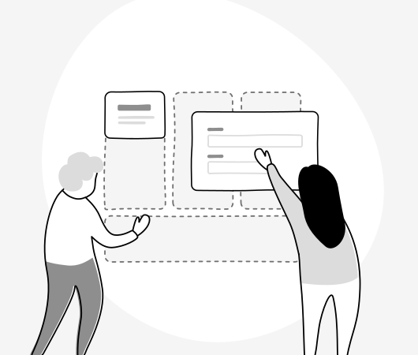



## Grundprincipper {#}

Dit fokus som designer af en selvbetjeningsløsning bør være på brugervenlighed og brugernes effektivitet igennem selvbetjeningsløsningen, ikke på personligt at “shine” ved brug af “krom” og tidens trends. Designsystemet følger nogle grundprincipper, som du bør kende.

Principperne skal sikre, at designsystemets komponenter kan anvendes hver for sig og sammen i uendelige kombinationer i de mange forskellige selvbetjeningsløsninger, som kan tilgås fra borger.dk og Virk. Designet sikrer en brugervenlighed og ensretning på tværs af løsninger samtidig med, at det tager højde for både borger.dk og Virk med hver deres visuelle brand.

Designet er:

- Neutralt
- Simpelt
- Målrettet til selvbetjeningsløsninger

## Dit ansvar som designer {#}

Følg allerede etablerede standarder og konventioner for placering og gruppering af komponenter og reproducer gængse interaktionsmønstre. 

Hav forståelse for dit ansvar for sammenhængen i mellem og på tværs af de mange tusinde selvbetjeningsløsninger, der kan tilgås fra borger.dk og Virk. Ved at tage ansvar, er du med til at gøre brugerne mere effektive, så de ikke skal genlære alle offentlige brugergrænseflader forfra hver gang.

Overvej følgende spørgsmål, før du designer nye funktioner til din løsning:

- Er funktionen nødvendig?
- Tilfører funktionen merværdi for brugeren?
- Kan vi gøre funktionen tilgængelig?
- Kan vi løse behovet med en mere simpel og gennemprøvet funktion?

## Designressourcer {#}

Vi stiller designbiblioteket til rådighed for, at I kan komme hurtigt i gang med at designe jeres selvbetjeningsløsninger og lave interaktive prototyper til brugertest. Filen vedligeholdes løbende og opdateres som udgangspunkt ved hver release. Vær dog opmærksom på, at “source of truth” er dokumentationssiden www.designsystem.dk og ikke designfilen.

    

        

            

                
            

            

                <h3 class="card-heading">Designbibliotek i Figma</h3>
                
Det Fælles Designsystems fil i Figma Community indeholder styleguide og komponenter, som du kan hente ned og bruge i dit eget projekt.

                <ul class="nobullet-list card-actions">
                    <li>
                        <a href="https://www.figma.com/community/file/1284147195952477019/det-flles-designsystem" class="icon-link" target="_blank">Designbibliotek version 11.0.0<svg class="icon-svg" aria-label="(åbner i nyt vindue)" focusable="false"><use href="#open-in-new"></use></svg></a>
                    </li>
                </ul>
            

        

    

<h3 id="hjaelp-os-med-at-blive-bedre">Hjælp os med at blive bedre</h3>

Hvis du anvender vores designressourcer og finder fejl eller har idéer til forbedringer, så tøv ikke med at .
